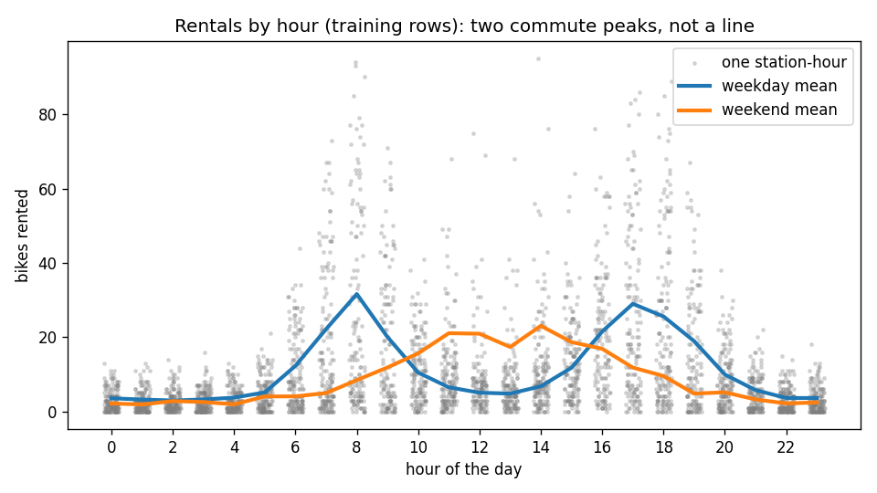
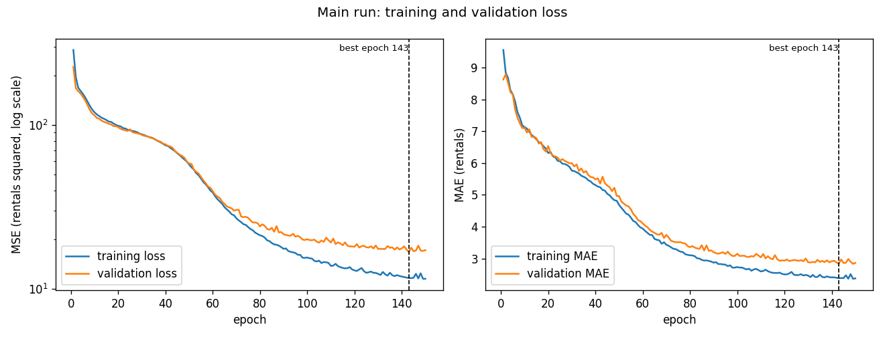
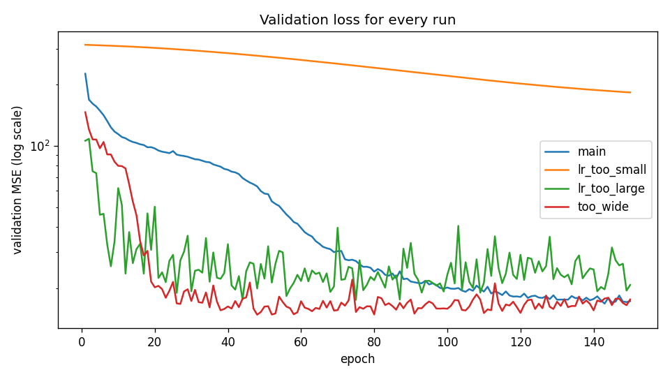

# Lakeshore Bike Demand

## What it does

This project predicts how many bikes will be rented from a Lakeshore Bike Share
station in a given hour, from the hour, the weather, the day type and the station
type. It trains a small neural network with a training loop written by hand in
PyTorch, and compares it honestly with two simple baselines: always predicting the
training mean, and a linear regression.

## How to run it

```bash
conda env create -f environment.yml
conda activate lab07-first-principles

python train.py            # recreates everything in reports/

python -m ruff format --check .
python -m ruff check .
python -m pytest
```

`python train.py` takes about a minute on a laptop CPU. It prints the loss every
25 epochs for each run, then the results tables.

## Data and split

`bikes_data.py` (given, unchanged) builds 6,000 station-hours from a fixed seed.
The features are `hour`, `temperature_c`, `rain_mm`, `wind_kph`, `is_weekend` and
`station_type`; the target is `rentals`.

The table is split **before any preparation** into 60% training (3,600 rows), 20%
validation (1,200) and 20% test (1,200) rows, with `random_state=2026`
(`prepare.split_frame`). The `StandardScaler` for the numeric columns and the
`OneHotEncoder` (followed by a scaler) for `station_type` are fitted on the
**training rows only** and then applied unchanged to the validation and test rows.
If they were fitted on all rows, the validation and test rows would leak their
means and spreads into training and the scores would look better than they will
be on new data. A test checks that the training features average zero and the
validation features do not.

The validation rows are used to choose the epoch and the run. The test rows are
used once, at the end of `train.py`, for the final number.

## Model and training

- **Network** (`model.py`): `BikeNet`, a fully connected network
  8 inputs → 64 → ReLU → 64 → ReLU → 1 output. The output has no activation
  because the target is a count, not a probability. `forward` returns shape
  `(N,)` so it matches the targets; the loop raises an error if the shapes differ.
- **Loss**: mean squared error (`nn.MSELoss`) on the raw count of rentals. MAE in
  rentals is reported alongside, because planners think in bikes.
- **Optimizer**: Adam, learning rate 0.001.
- **Batches**: `RentalsDataset` returns one row at a time as float32 tensors.
  Batches of 64; only the training loader shuffles.
- **Epochs**: 150. `fit` logs training loss, validation loss and validation MAE
  every epoch and puts back the weights of the epoch with the lowest validation
  loss.
- **Seeds**: `train.py` seeds Python, NumPy and PyTorch with 2026 before every run
  (`set_seed`) and gives the training DataLoader a `torch.Generator` seeded with
  2026. Running `python train.py` twice on the same computer gives identical
  numbers; another computer may differ in the last digits.

The loop (`train.run_epoch`) is written by hand: forward pass, loss,
`optimizer.zero_grad()`, `loss.backward()`, `optimizer.step()`. Without an
optimizer the same function only measures, under `torch.no_grad`.

## Results

Mean absolute error in rentals (lower is better). `train.py` picks the final
network as the run with the lowest validation MAE. That was the `too_wide` run
(two hidden layers of 1,024), using its weights from epoch 48. The test rows were
then used once for that network. The main 64×64 run was close behind, with a
validation MAE of 2.83.

| Model | Validation MAE | Test MAE |
|---|---|---|
| Training mean (10.55 bikes) | 9.71 | 9.75 |
| Linear regression | 8.85 | 8.66 |
| Neural network (too_wide run, weights from epoch 48) | **2.57** | **2.45** |

**Why the linear model does poorly.** Rentals do not rise or fall steadily with
the hour: on weekdays there are two commute peaks (about 8:00 and 17:30) with a
dip between them, at weekends there is one midday hump, and park stations behave
differently from downtown ones. Temperature helps most near 21 °C and less on both
sides. A straight line in these features cannot bend to follow any of that, so it
only beats the mean by about one bike.



**Learning curves of the main run**



The curves fall in two stages. In the first ten epochs both losses drop fast as
the network learns the overall level of rentals. They then flatten until about
epoch 45, and drop steeply a second time between epochs 45 and 80, which is when
the network learns the commute peaks and the weekend hump. After that both curves
improve slowly. The best validation loss (16.77) comes at epoch 143, near the end,
so the main run was not overfitting yet. From about epoch 70 a gap opens between
the training loss (11.5 at the end) and the validation loss (17.2): the network
fits the rows it trains on a little more closely than new rows, but the gap grows
only slowly and the validation loss is still flat or falling.

## Experiments

Each run changes one setting from the main run. Curves for every run are in
`reports/curves_<run>.png`, and all validation curves are compared in
`reports/experiments_val_loss.png`.

| Run | Changed | Best epoch | Best val MAE | Final train loss | Final val loss |
|---|---|---|---|---|---|
| main | nothing | 143 | 2.829 | 11.534 | 17.236 |
| lr_too_small | learning rate 1e-3 → 1e-5 | 150 | 8.557 | 191.140 | 182.861 |
| lr_too_large | learning rate 1e-3 → 1e-1 | 75 | 2.937 | 16.962 | 20.715 |
| too_wide | hidden width 64 → 1024 | 48 | 2.573 | 7.692 | 17.571 |



- **main: fine.** Training and validation loss fall together. The best epoch
  is 143 of 150, so the run was still slowly improving at the end. The gap
  between training and validation loss stays roughly constant.
- **lr_too_small: underfitting.** With a learning rate 100 times smaller the
  steps are tiny. After 150 epochs both losses are still about 180–190, far above
  every other run, and the validation MAE (8.56) is no better than the linear
  model. The best epoch is the last one, so the curves are still falling: the run
  needed far more time, not less.
- **lr_too_large: unstable.** With a learning rate 100 times larger the network
  learns fast but does not settle. The best validation loss comes at epoch 75 and
  is worse than the main run's; the validation loss at the end (20.7) is higher
  than at epoch 75, and the curve jumps up and down from epoch to epoch because
  each step overshoots the minimum.
- **too_wide: overfitting, rescued by early stopping.** About a million weights
  for 3,600 rows. The training loss keeps falling to 7.7, the lowest of any run,
  while the validation loss reaches its best (14.8) at epoch 48 and then climbs
  back to 17.6, so the gap between the curves widens. The network is starting to
  memorize the random noise in the counts. Because `fit` puts back the epoch-48
  weights, this run still has the best validation MAE (2.57), which is why it was
  chosen. Without that, its final weights would be no better than the main run.

## Limitations

- **The data are invented.** `bikes_data.py` generates rows from a formula plus
  random noise. The model learns that formula, not real Lakeshore riders, so none
  of these numbers say how it would do on a real network.
- **Irreducible noise.** Rentals are random counts around an expected value, so
  even a perfect model has an MAE of several bikes at busy hours. The network
  predicts an average, not the exact number.
- **What it cannot see.** There are no dates, seasons, holidays, events, station
  IDs, station capacity, bikes already at the station or the previous hour's
  rentals. Every station of one type is treated the same.
- **Range.** It has only seen temperatures from about −15 to 35 °C, rain up to
  15 mm and wind up to 60 km/h; predictions outside that range are guesses. It
  can also predict a small negative number, which should be read as zero.
- **What not to use it for.** Use it as one input to rebalancing decisions, not as
  a guarantee that a station will have demand, and not for long-term planning such
  as where to build stations, pricing, or judging staff or neighbourhoods.
